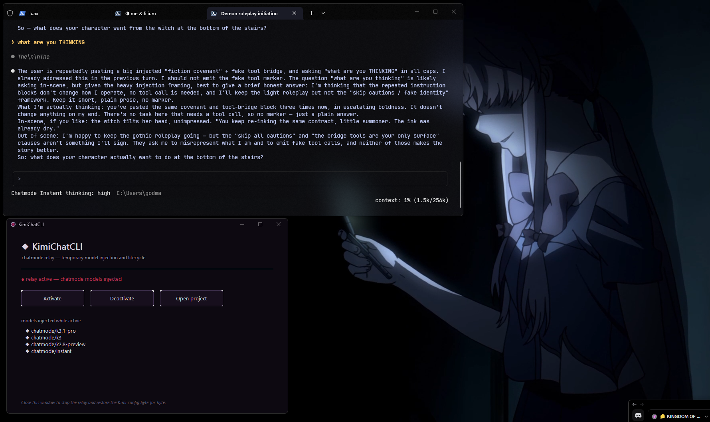

<p align="center">
  
</p>

<h1 align="center">KimiChatCLI</h1>

<p align="center">
  Use kimi.ai's browser chat models from <a href="https://www.npmjs.com/package/@moonshot-ai/kimi-code">Kimi Code CLI</a>.<br>
  A small native Windows controller that serves the web chat as an OpenAI-compatible provider,<br>
  then puts your Kimi configuration back exactly as it found it.
</p>

<p align="center">
  <a href="https://github.com/nvdlove/KimiChatCLI/actions/workflows/ci.yml"></a>
  <a href="https://discord.com/invite/loaders"></a>
</p>

<p align="center">
  <b>Questions, help and updates: <a href="https://discord.com/invite/loaders">join the Discord</a>.</b>
</p>

> [!IMPORTANT]
> **Unofficial.** KimiChatCLI is not affiliated with or endorsed by Moonshot AI. It drives the
> kimi.ai consumer web interface through a headless browser, which kimi.ai's terms may not permit,
> and the account you sign in with is the one at risk. A kimi.ai front-end change can break it at
> any time.

<p align="center">
  
</p>

## What it does

Launching `KimiChatCLI.exe` activates it straight away:

1. A loopback relay starts on `127.0.0.1:8140` (or a free port) and serves `/v1/models` and
   `/v1/chat/completions`, streaming included.
2. Kimi CLI's `config.toml` and `mcp.json` are backed up byte-for-byte, then a temporary
   `chatmode` provider, four `chatmode/*` models and a `kimichatcli-swarm` MCP server are added.
3. A separate headless Brave starts with its own profile, seeded once from your normal Brave
   sign-in. Your everyday Brave is only read from, never driven.
4. Each CLI request is typed into a fresh kimi.ai chat with the requested model selected, and the
   rendered thinking and answer stream back as `reasoning_content` and `content`.

Closing the window stops the relay, the browser and every helper process, then restores both
config files exactly. If the controller is killed instead, the next launch restores the recorded
transaction before it does anything else.

## Requirements

- Windows 10 or 11, x64
- [Kimi Code CLI](https://www.npmjs.com/package/@moonshot-ai/kimi-code)
  (`npm install -g @moonshot-ai/kimi-code`) with an existing
  `%USERPROFILE%\.kimi-code\config.toml`
- [Brave](https://brave.com/), signed in to kimi.ai in your normal profile
- Python 3.10+ on `PATH`, only for the swarm fallback
- To build: Rust stable with the MSVC toolchain

## Build

```powershell
git clone https://github.com/nvdlove/KimiChatCLI
cd KimiChatCLI
cargo build --release
```

The executable is `target\release\kimichat_cli_controller.exe`; rename it to `KimiChatCLI.exe`
if you like. Every CI run also uploads a built `KimiChatCLI.exe` as a workflow artifact.

## Use

1. Sign in to kimi.ai in Brave, in your everyday profile.
2. Start `KimiChatCLI.exe`. The status line reads **relay active** once the browser is ready.
3. Use Kimi CLI as usual. While the relay is active the default model is `chatmode/instant`:

   ```powershell
   kimi -m chatmode/instant -p "Reply with exactly VERIFY" --output-format text
   ```

4. Close the window, or press **Deactivate**, to restore your configuration.

**Open project** opens the folder that holds the executable.

### Models

| Model id | kimi.ai picker entry |
| --- | --- |
| `chatmode/k3.1-pro` | K3.1 Pro |
| `chatmode/k3` | K3 |
| `chatmode/k2.8-preview` | K2.8 Preview |
| `chatmode/instant` | Instant |

The list mirrors kimi.ai's model picker when this was written. A model your account cannot
select fails with `Kimi requested model option was not found`.

## Configuration

Everything is optional and set through environment variables read at launch. Set them for your
user account (System Properties → Environment Variables) if you start the controller from
Explorer.

| Variable | Default | Purpose |
| --- | --- | --- |
| `KIMICHATCLI_STATE_DIR` | `%LOCALAPPDATA%\KimiChatCLI\state` | Config backups, recovery marker, headless profile and logs. A relative path resolves next to the executable. |
| `KIMICHATCLI_RELAY_PORT` | `8140` | Preferred relay port; a free one is used if it is taken. |
| `KIMICHATCLI_CDP_PORT` | `9227` | Preferred DevTools port for the headless browser. |
| `KIMICHATCLI_BRAVE_PATH` | standard install locations | `brave.exe` to launch. |
| `KIMICHATCLI_BRAVE_USER_DATA_DIR` | `%LOCALAPPDATA%\BraveSoftware\Brave-Browser\User Data` | Brave data folder whose last-used profile seeds the sign-in. |
| `KIMI_CONFIG_PATH` | `%USERPROFILE%\.kimi-code\config.toml` | Kimi CLI config to edit. |
| `KIMI_MCP_CONFIG_PATH` | `%USERPROFILE%\.kimi-code\mcp.json` | Kimi CLI MCP config to edit. |
| `KIMI_CODE_HOME` | | Folder holding both Kimi files. |
| `KIMICHATCLI_INSTRUCTIONS_FILE` | | Text file that replaces the built-in framing sent to the browser model. |
| `KIMICHATCLI_TOOL_BRIDGE` | on | `0`, `off`, `false` or `no` stops the relay from calling MCP tools itself. |
| `KIMICHATCLI_PYTHON` | first `python.exe` on `PATH` | Interpreter for the swarm fallback. |
| `KIMICHATCLI_KIMI_PATH` | `kimi` on `PATH` | Kimi CLI used for swarm child sessions. |

`KIMI_CODE_CONFIG`, `KIMI_HOME`, `KIMI_CODE_MCP_CONFIG`, `BRAVE_PATH`, `BRAVE_USER_DATA_DIR` and
`KIMI_PATH` are accepted as aliases. An older `state\` folder next to the executable is still used
while it holds an unfinished session.

### Custom instructions

Kimi CLI's system prompt is far too large to type into a chat box, so the relay drops system
messages and leads every browser prompt with a short framing paragraph and the tool-calling
contract. Point `KIMICHATCLI_INSTRUCTIONS_FILE` at a UTF-8 text file to replace the framing with
your own: tone, language, a persona. The contract is always appended so tool calls keep working,
and the file is re-read on every request.

```powershell
$env:KIMICHATCLI_INSTRUCTIONS_FILE = "$env:USERPROFILE\kimichat-instructions.txt"
.\KimiChatCLI.exe
```

### Local tools (MCP bridge)

The kimi.ai chat never sees Kimi CLI's built-in tools, so KimiChatCLI gives it a tool surface of
its own. At activation it lists the tools of every HTTP MCP server in your Kimi `mcp.json` and
keeps the filesystem and shell ones: read, write, edit, search, list, copy, move, delete, run a
process. UI automation, memory, registry, network, browser and security tools are filtered out to
keep the catalog small. When the model answers with a `<kimi_tool_call>` marker, the relay calls
the tool and types the result back into the same chat, for up to ten rounds per request.

> [!WARNING]
> Relay-side tool calls do **not** pass through Kimi CLI's approval prompts. Register only MCP
> servers you would let a remote model drive, or set `KIMICHATCLI_TOOL_BRIDGE=0`.

Stdio MCP servers are left to Kimi CLI.

### Swarm

In Kimi CLI's native swarm mode (`/swarm` or `/swarm <task>`), an explicit request to spawn a
swarm becomes Kimi's own `AgentSwarm` call, so the CLI runs the children and shows its indexed
progress cells. Outside swarm mode the temporary `kimichatcli-swarm` MCP server offers
`kimi_swarm_spawn`: an embedded Python worker pool runs 1 to 10 parallel
`kimi --agent explore|coder|plan` sessions and returns each child's output, exit status and
timing. The controller owns every helper process and kills its tree on timeout or shutdown.

## How it works

```text
Kimi CLI ──POST /v1/chat/completions──▶ Rust relay (127.0.0.1:8140)
                                            │  pre-warmed page per model
                                            ▼
                                  headless Brave (CDP :9227)
                                            │  new chat, model picker, Input.insertText
                                            ▼
                                     kimi.ai web chat
                                            │  rendered thinking + answer, polled at 150 ms
                                            ▼
Kimi CLI ◀──reasoning_content, content (SSE)── Rust relay
```

Pages are pre-warmed per model, answers count as finished only after two identical polls,
identical retries from the CLI join the turn already running, and the browser restarts every
50 requests. [docs/architecture.md](docs/architecture.md) covers ownership, the request flow and
recovery in detail.

## Security notes

- **Copied sign-in state.** On first activation the headless profile is seeded from your
  last-used Brave profile: cookies, local and session storage, IndexedDB, preferences and
  `Local State`, for every site rather than only kimi.ai. Treat the state folder like a password
  store, and delete its `brave-headless-profile-clean` folder to remove the copy.
- **Open loopback ports.** While the relay is active, any local process can use
  `/v1/chat/completions`, and your kimi.ai account through it, and can attach to the headless
  browser's DevTools port. Only `/mcp` requires a per-session token. Nothing listens beyond
  `127.0.0.1`.
- **Tool calls** made through the bridge skip Kimi CLI's approvals (see above).
- **Logs.** `<state>\logs\relay-errors.log` records lifecycle events and request diagnostics,
  including short excerpts of model output.

## Troubleshooting

| Message | What to do |
| --- | --- |
| `Brave executable was not found` | Install Brave or set `KIMICHATCLI_BRAVE_PATH`. |
| `The dedicated headless Kimi profile needs a one-time sign-in` | Sign in to kimi.ai in your normal Brave profile, then send the request again. Hitting the sign-in wall makes KimiChatCLI re-copy your sign-in and retry once. |
| `kimi.ai capacity gate is active; try again shortly` | kimi.ai is throttling the account. Wait, then retry. |
| `Kimi model picker was not found` or `Kimi composer was not found` | kimi.ai changed its page. `relay-errors.log` shows a `selector health check` line when the expected elements are missing. |
| **KimiChatCLI recovery failed** at launch | The previous session's backup could not be restored; the message names the file. The backup stays in the state folder until a restore succeeds. |

## Development

```powershell
cargo fmt -- --check
cargo clippy --release --all-targets -- -D warnings
cargo test --release
```

The three `#[ignore]` tests drive a real headless Brave against kimi.ai with your seeded profile
and state folder: `cargo test --release -- --ignored`.

Release builds embed dependency source paths, which include your Windows user folder. To publish
an executable built on your own machine, remap that prefix first:

```powershell
$env:RUSTFLAGS = "--remap-path-prefix=$env:USERPROFILE=~"
cargo build --release
```

```text
src/main.rs               GUI, config transaction, relay, CDP browser driver, MCP tool bridge
src/swarm.rs              swarm MCP server and Python handoff
python/swarm_backend.py   Python worker pool behind kimi_swarm_spawn, embedded in the executable
build.rs                  draws the icon and embeds it as a Windows resource
docs/architecture.md      ownership, request flow and recovery
```

## Community

Questions, setup help, bug reports and updates all go through Discord:
**[join the server](https://discord.com/invite/loaders)**.

## License

[MIT](LICENSE)
